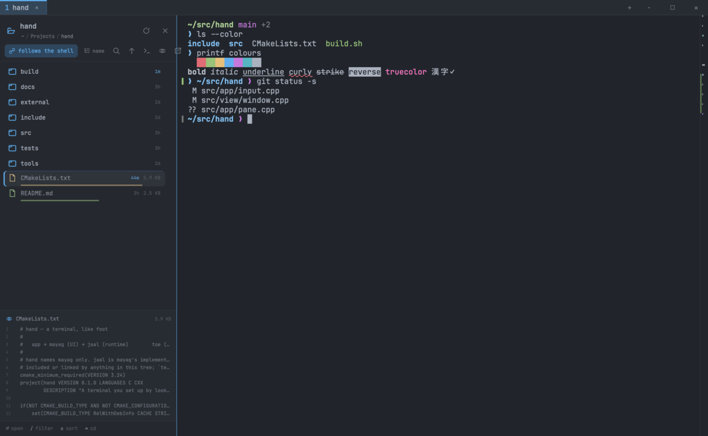
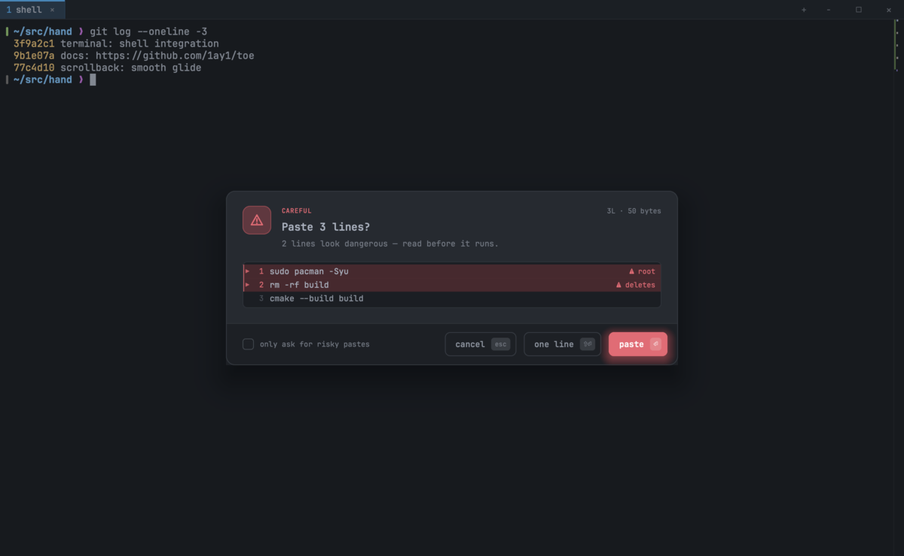
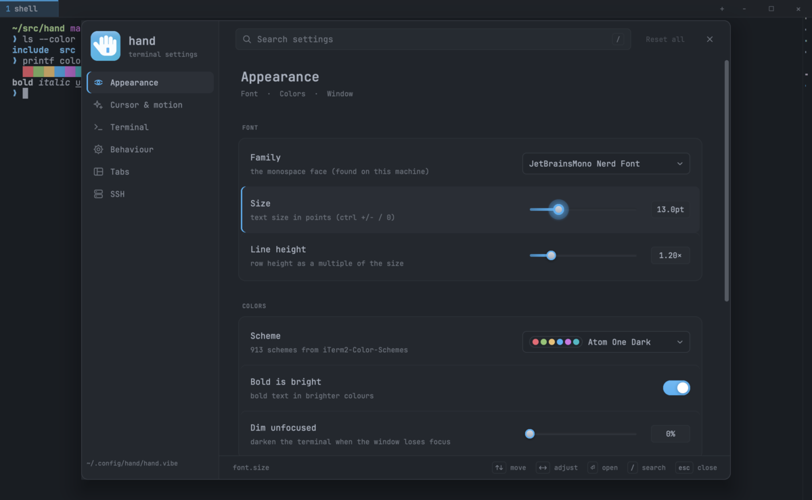
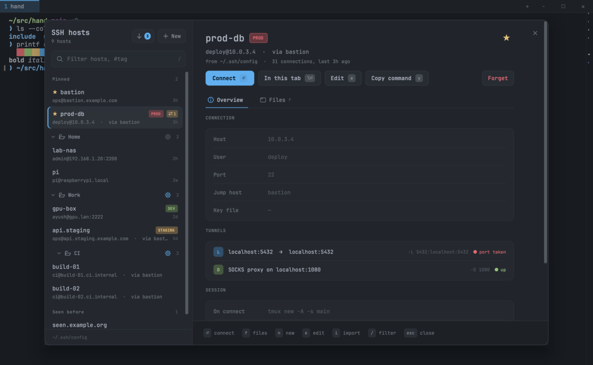

# hand

A terminal. As plain as foot: open it and you get a shell, nothing in the
way. Tabs, search, hints, copy mode, a file pane and SSH are there when you
reach for them.



Built on [toe](external/toe) (the VT engine), [mayag](external/mayag) (the
GPU UI) and [vibe](external/vibe) (the config format). Linux (Wayland), macOS
and Windows.

- **Knows your shell.** Prompts are marked, so a failed command gets a red
  mark in the gutter. You can jump prompt to prompt, copy a command's whole
  output, and see a running command's timer in a sticky header.
- **Asks before it hurts.** A multi-line or risky paste (`sudo`, `rm -rf`,
  `curl | sh`, control characters) shows every line first, flagged. Closing
  a tab or the window while something runs asks too. Both are configurable.
- **SSH without leaving.** A picker and a full host manager read
  `~/.ssh/config` the way ssh does. They show folders, live tunnels and
  remote files, and a dropped connection keeps its tab.
- **Everything is a setting.** `ctrl+,` edits all of them live, from a table
  that also writes `hand.vibe`.

| | |
|---|---|
|  |  |
|  | |

## Keys

Every hand chord is `ctrl+shift+…`; plain `ctrl+…` goes to the program in the
terminal.

| keys | |
|---|---|
| `ctrl+shift+t` / `w` | new tab / close tab |
| `ctrl+tab`, `ctrl+pgup/pgdn`, `ctrl+shift+←/→` | previous / next tab |
| `alt+1` … `alt+9` | go to tab N |
| `ctrl+shift+pgup/pgdn` | move the tab |
| `ctrl+shift+s` / `h` | SSH picker / host manager |
| `ctrl+shift+e` | the file pane (follows the shell's directory) |
| `ctrl+shift+f` | search the scrollback |
| `ctrl+shift+space` | hints: pick a URL / path / hash on screen |
| `ctrl+shift+m` | copy mode (vim keys through the scrollback) |
| `ctrl+shift+z` / `x` | previous / next prompt |
| `ctrl+shift+g` | copy the last command's output |
| `ctrl+shift+c` / `v` | copy / paste |
| `ctrl+=` / `-` / `0` | font size |
| `shift+pgup/pgdn`, `shift+home/end` | scroll |
| `ctrl+,` | settings |

## SSH

`ctrl+shift+s` lists every host in `~/.ssh/config` (read the way ssh reads
it: first value wins, globs, `Include`), the machines in `known_hosts`, and
any `user@host[:port]` you typed once. Pinned and recent hosts come first.
Enter connects in a new tab; one connection per host is shared, so a second
tab opens instantly. A production host (by name, or `env prod` in
`hosts.vibe`) is marked red; a dropped connection keeps its tab and offers to
reconnect. `~/.ssh/config` is never written; hand's notes on your hosts live
in `hosts.vibe` beside `hand.vibe`.

## Settings

`ctrl+,` opens settings over the terminal. Every edit applies live and is saved to
`~/.config/hand/hand.vibe` (the file is generated from the settings table in
`src/config/settings.cpp`; every key is a setting). Colours come from all 913
[iTerm2-Color-Schemes](https://github.com/mbadolato/iTerm2-Color-Schemes);
regenerate the catalogue with `tools/gen_schemes.py`.

## Build

```sh
git submodule update --init --recursive
cmake -S . -B build -DCMAKE_BUILD_TYPE=Release
cmake --build build --target hand
./build/hand                              # the terminal
./build/hand --headless --last-resort     # the self-test (also: ctest)
./build/hand --png out.png --shot tabs    # a screenshot (tabs, settings, hosts, ssh, ...)
```

## How it is built

One Elm-style program. The state is plain typed data, every event is one
leaf of a closed tree of message types, and `update` is the only place state
changes. The code is in four layers, each a library that can only include
the ones below it:

```
core ◀─ config ◀─┐
core ◀─ ssh    ◀─┴─ app (update, input, view) ◀─ hand (main, run modes)
```

`ctest` runs the headless self-test (218 checks, real shells on real ptys)
and the `layering` lint, which fails on an upward include or an anonymous
model edit. The details are in [docs/ARCHITECTURE.md](docs/ARCHITECTURE.md).
